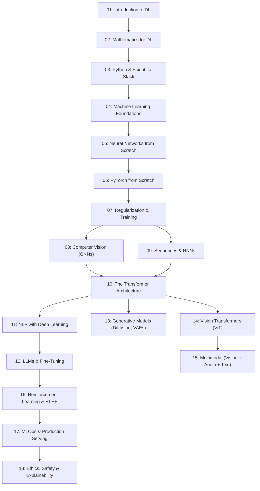

# Zero to Hero — Deep Learning

> A structured, first-principles learning path from mathematical foundations to modern Transformers, LLMs, and Multimodal systems.

Each module is an interactive Jupyter Notebook (`.ipynb`) built on a strict pedagogical standard:
- **Notes First:** Conversational explanations, real-world analogies, step-by-step deep dives, ASCII diagrams, and quick reference tables.
- **Code Second:** Hands-on Python, NumPy, and PyTorch implementations with clear comments and visible execution outputs.

---

## Curriculum Roadmap



---

## Modules & Progress

| # | Module | Key Topics | Status / Notebook |
|:---:|---|---|:---:|
| **1** | **Introduction to Deep Learning** | What is DL, Roles & Responsibilities, Product Impact, DL vs Traditional ML | [Chapter 1](Module-01-Introduction/Chapter-01-Introduction.ipynb) |
| **2.1** | **Linear Algebra** | Scalars, Vectors, Matrices, Tensors, MatMul, Dot Products, Transpose, Inverses, Eigenvalues, L1/L2 Norms | [Chapter 2.1](Module-02-Mathematics/Chapter-02.1-Linear-Algebra.ipynb) |
| **2.2** | **Calculus & Differentiation** | Derivatives, Partial Derivatives, Chain Rule, Gradients, Steepest Descent, Autograd Graphs | [Chapter 2.2](Module-02-Mathematics/Chapter-02.2-Calculus-and-Differentiation.ipynb) |
| **2.3** | **Probability & Statistics** | Gaussian/Bernoulli/Uniform Distributions, Mean/Var/Std, Normalization, Bayes' Theorem, MLE, KL Divergence | [Chapter 2.3](Module-02-Mathematics/Chapter-02.3-Probability-and-Statistics.ipynb) |
| **2.4** | **Information Theory Basics** | Shannon Entropy, Cross-Entropy Loss, Equivalence of Cross-Entropy and Negative Log-Likelihood | [Chapter 2.4](Module-02-Mathematics/Chapter-02.4-Information-Theory-Basics.ipynb) |
| **3.1** | **NumPy for Deep Learning** | Arrays vs Python Lists, Memory Layout, Strides, Broadcasting, SIMD Vectorization, Slicing & Stacking | [Chapter 3.1](Module-03-Scientific-Stack/Chapter-03.1-NumPy.ipynb) |
| **3.2** | **Pandas for Tabular DL** | DataFrames & Series, Missing Value Imputation, GroupBy & Merging, Feature Engineering, PyTorch Export | [Chapter 3.2](Module-03-Scientific-Stack/Chapter-03.2-Pandas.ipynb) |
| **3.3** | **Matplotlib & Seaborn** | Training/Val Loss Curves, Overfitting Diagnosis, Distribution KDEs, Correlation Heatmaps, Confusion Matrices, Image Grids | [Chapter 3.3](Module-03-Scientific-Stack/Chapter-03.3-Matplotlib-and-Seaborn.ipynb) |
| **4.1** | **Core ML Concepts** | Learning Paradigms (Supervised, Unsupervised, Self-Supervised), Bias-Variance Tradeoff, Train/Val/Test Splits, K-Fold CV, Metrics (Accuracy, Precision, Recall, F1, ROC-AUC) | [Chapter 4.1](Module-04-Machine-Learning/Chapter-04.1-Core-ML-Concepts.ipynb) |
| **4.2** | **Classical Algorithms** | Baselines for DL, Linear Regression (OLS & GD), Logistic Regression, Decision Trees (Entropy & Gini), Random Forests, Gradient Boosting (XGBoost / LightGBM) | [Chapter 4.2](Module-04-Machine-Learning/Chapter-04.2-Classical-Algorithms.ipynb) |
| **4.3** | **Unsupervised Learning** | K-Means Clustering (Centroid updates & Elbow method), Principal Component Analysis (PCA, SVD, Explained Variance) | [Chapter 4.3](Module-04-Machine-Learning/Chapter-04.3-Unsupervised-Learning.ipynb) |
| **4.4** | Feature Engineering | Categorical Encodings (One-Hot, Target, Ordinal), Normalization vs Standardization, Handling Imbalance (SMOTE, Class Weights) | *Coming soon* |
| **5** | Neural Networks from Scratch | Perceptron, Multi-Layer Perceptron (MLP), Activation Functions (ReLU, GELU, SiLU), Backprop, Optimizers | *Coming soon* |
| **6** | PyTorch from Scratch | Tensor operations, GPU acceleration, Autograd tape, `nn.Module`, DataLoaders, Training Loop | *Coming soon* |
| **7** | Regularization & Training | Dropout, Weight Decay (L1/L2), Weight Initialization (He/Xavier), BatchNorm, LR Schedules, Augmentation | *Coming soon* |
| **8** | Convolutional Networks (CNNs) | Convolutions, Kernels, Padding/Stride, Pooling, Classic CNNs (LeNet to ResNet), Skip Connections, Transfer Learning | *Coming soon* |
| **9** | Sequence Modeling & RNNs | Sequential data, RNNs, Backprop Through Time (BPTT), LSTMs, GRUs, Seq2Seq, Attention mechanism | *Coming soon* |
| **10** | The Transformer Architecture | Scaled Dot-Product Attention, Multi-Head Attention, Positional Encodings (RoPE), Full Transformer Block | *Coming soon* |
| **11** | NLP with Deep Learning | Tokenization (BPE), Word Embeddings (Word2Vec), Language Modeling, BERT vs GPT, Modern NLP tasks | *Coming soon* |
| **12** | LLMs & Fine-Tuning | Pre-training dynamics, Scaling laws, SFT, RLHF, DPO, PEFT (LoRA, QLoRA), INT8/INT4 Quantization | *Coming soon* |
| **13** | Generative Models | Autoencoders, Variational Autoencoders (VAEs), Generative Adversarial Networks (GANs), Diffusion Models (DDPM) | *Coming soon* |
| **14** | Vision Transformers (ViT) | Patch embeddings, [CLS] token, ViT vs CNN trade-offs, Modern Vision Models (CLIP, DINOv2, SAM) | *Coming soon* |
| **15** | Multimodal Deep Learning | Vision-Language alignment (CLIP), Image Captioning, Vision-Language Models (VLMs), Audio & Whisper | *Coming soon* |
| **16** | Reinforcement Learning & RLHF | MDPs, Q-Learning, Deep Q-Networks (DQN), Policy Gradients, PPO, Human Preference Alignment | *Coming soon* |
| **17** | MLOps & Production Serving | Experiment tracking (W&B), Quantization & Pruning, ONNX export, FastAPI serving, Docker, vLLM | *Coming soon* |
| **18** | Ethics, Safety & Explainability | Algorithmic bias, Hallucination mitigation, Differential Privacy, Interpretability (GradCAM, SHAP) | *Coming soon* |

---

## Getting Started

```bash
# Clone the repository
git clone https://github.com/Aadarshttech/zero-to-hero-deep-learning.git
cd zero-to-hero-deep-learning

# Set up environment & Jupyter
pip install jupyter numpy

# Launch notebook interface
jupyter notebook
```

---

## Learning Philosophy

> **Notes first. Code second.**  
> Every concept starts with deep conceptual intuition and real-world analogies before touching code.
